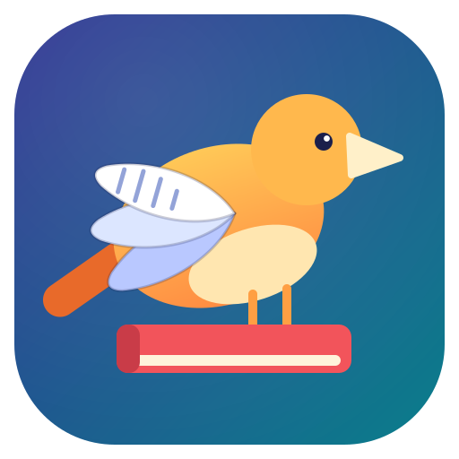

<p align="center">
  
</p>

<h1 align="center">Bookfinch</h1>

<p align="center">
  <strong>Search and download free, legal books from 21 open sources at once.</strong><br>
  One search box, merged results, the format you prefer. No dependencies.
</p>

<p align="center">
  
  
  
</p>

---

Bookfinch is a small desktop app (Tkinter, standard library only) that queries **21 free and legal book sources**
in parallel: Open Library, Project Gutenberg, Google Books, Internet Archive, Wikisource, Zenodo, OpenAlex, DOAB,
OAPEN, LibriVox, Wikimedia Commons, Library of Congress, Gallica/BnF, Unglue.it, Wolne Lektury, Europeana,
textos.info, Feedbooks, Wikibooks, DSpace repositories (Digital.CSIC, e-Archivo UC3M) and CORE.
It merges duplicates, ranks the results by relevance and lets you download the format you want.

## Features

- **21 sources queried in parallel**, with live progress and clear reporting of which sources did not answer.
- **Duplicate merging**: the same book found in several places becomes one row with all its formats
  (subtitle variants are recognised; audiobooks and different authors are never mixed up).
- **Search by title, author or ISBN** (10/13 digits, with or without hyphens). ISBN searches look in every language.
- **Ten languages** to choose from, plus *All languages*. The chosen language is a relevance preference, not a hard filter.
- **Automatic widening**: if a search returns fewer than 40 books, it is repeated in all languages, without
  stop words and with single keywords. **＋ More results** requests the next page from every source.
- **Safe downloads**: only `http(s)` URLs, content checks (a web page is rejected when a PDF/EPUB was expected),
  incomplete downloads are detected, and every download can be cancelled.
- **Filters and sorting**: *Flexible*, *Strict* or *No filter*; sort by relevance, title, author, year, language,
  number of formats or number of sources.
- **Export to CSV**, search history, context menu, keyboard shortcuts.
- **Portable mode** (settings, history and log next to the program) and a crisp UI on high-DPI screens.
- Network layer with retries, a 5-minute cache, gzip and cancellation. 60 unit tests, none of which touch the internet.

## Quick start

**Run from source** (Python 3.9+ with Tkinter, which the official installer from python.org includes):

```bash
python app.py
```

On Windows you can also double-click `run.bat`.

**Prebuilt Windows `.exe`:** build it yourself (below) or grab the zip produced by the GitHub Actions workflow.
If `portable.txt` sits next to `Bookfinch.exe`, everything the app saves lives in the `data` folder beside it, so you
can carry it on a USB stick. Delete `portable.txt` to store data in `%APPDATA%\Bookfinch` instead.

## Usage

- Type a **title, author or ISBN** and press Enter.
- **Enter / double-click** on a book downloads it. Right-click: open the page, copy the link or the title.
- **Esc** or the *Cancel* button stops a search; the *Cancel* next to *Download* stops a download.
- **Ctrl+L** jumps back to the search box. Previous searches are kept in the drop-down.
- Grey rows only have a web page (no direct download). *see on select* means the formats are looked up when you select the book.
- **☰ More**: export results to CSV, view the error log, open the data folder.
- **⚙ Settings**: your own search sites (`{q}` is replaced by what you typed), optional API keys for Google Books,
  Europeana and CORE, and a contact address that is added to the User-Agent (Open Library and other free APIs ask for it).
- **Also search the web ▾** opens sites that have no public API (Amazon Kindle, Smashwords, Hispana, Dialnet, and more) in your browser.

> The CSV export uses `;` as the delimiter and a UTF-8 BOM, so it opens directly in Excel on most European locales.

## Building the `.exe`

**On Windows** (Python 3.9+ is needed only to build):

| Command | Result |
|---|---|
| `build.bat` | A single portable `dist\Bookfinch.exe` plus `dist\Bookfinch-portable.zip` (unpacks into `%TEMP%` on launch: slightly slower start) |
| `build.bat dir` | A folder `dist\Bookfinch\` (starts faster, fewer antivirus warnings). **The `.exe` only works inside its folder, next to `_internal`** |

The script creates an isolated environment, installs PyInstaller, **runs the tests** and only builds if they pass.

**Without installing Python:** push this repository to GitHub. The workflow in `.github/workflows/build.yml` runs the
tests on Python 3.9–3.13 and builds on Windows, leaving both zips as an *artifact* of the run (*Actions* tab).
You can also trigger it manually with *Run workflow*.

If Windows SmartScreen warns about an "unknown publisher", that is normal for unsigned programs:
*More info → Run anyway*.

<details>
<summary><strong>"Failed to load Python DLL … \_internal\python3xx.dll"</strong></summary>

This is folder mode (`build.bat dir`) with the `.exe` moved **without** its `_internal` subfolder. Copy the whole
`Bookfinch` folder (or create a shortcut to the `.exe`), or build with plain `build.bat`, which produces a single `.exe`.
If `_internal` is there but the DLL is missing, your antivirus removed it: restore it from its history.
When building, prefer Python 3.12 or 3.13 over a freshly released version.
</details>

## A note on Spanish-language books

Bookfinch started life as a tool for finding books in Spanish, and that support is still a strength: Spanish
stop words are ignored when matching, `es_ES`/`Castellano` are recognised as Spanish, and several sources
(Europeana, which aggregates Hispana and the BNE; textos.info; Digital.CSIC and e-Archivo UC3M) are included
largely for Spanish-language material. Most modern Spanish books are still under copyright, so no legal tool can
show them: what Bookfinch can do is reach *all* the open Hispanic collections without losing books on technicalities.

## Status and limitations

- Only open-access and public-domain sources are used (no piracy sites). Lending (Open Library / Internet Archive)
  needs an account on their website: the app only takes you to the page.
- **Honest warning:** several sources (Wolne Lektury, Gallica, Unglue.it, Library of Congress, Wikimedia Commons,
  Europeana, textos.info, Feedbooks, Wikibooks, DSpace 7 repositories, CORE) were written from their public documentation
  without being able to test them against the live servers. If one fails, the status bar says so
  (*No response from N sources: …*), the rest keeps working and the details go to the error log.
  The most uncertain points are the DSpace 7 `/server/api` endpoints, the Europeana demo key, the Wolne Lektury
  `?search=` query and the Gallica `.pdf` link. If a download link does not deliver what it promises, the download is
  rejected with a clear message instead of saving a corrupt file.
- The Biblioteca Virtual Miguel de Cervantes and the Biblioteca Digital Hispánica offer no search API with downloads;
  their content reaches Bookfinch partly through Europeana and through the *Also search the web* menu.
- Every search sends what you type to the sources listed above, and nothing else.
- Settings and log live in `data\` next to the program (portable mode) or in `%APPDATA%\Bookfinch`.

## Development

```bash
python -m unittest discover -s tests -v     # tests (no dependencies, no internet)
python app.py                               # run the app
python tools/make_icon.py                   # regenerate icons from assets/logo.svg (needs Playwright)
```

```
app.py                   entry point
bookfinch/models.py      Item, languages, ISBN, text helpers
bookfinch/sources.py     parsers and queries for each source, external web sites
bookfinch/merge.py       duplicate merging, relevance, filters, sorting
bookfinch/net.py         JSON requests (retries, cache, cancellation) and downloads
bookfinch/settings.py    settings, portable mode, logging
bookfinch/ui.py          Tkinter interface
assets/logo.svg          logo (single source for every icon)
```

See [CHANGELOG.md](CHANGELOG.md) for the release history.

## License

[MIT](LICENSE)
